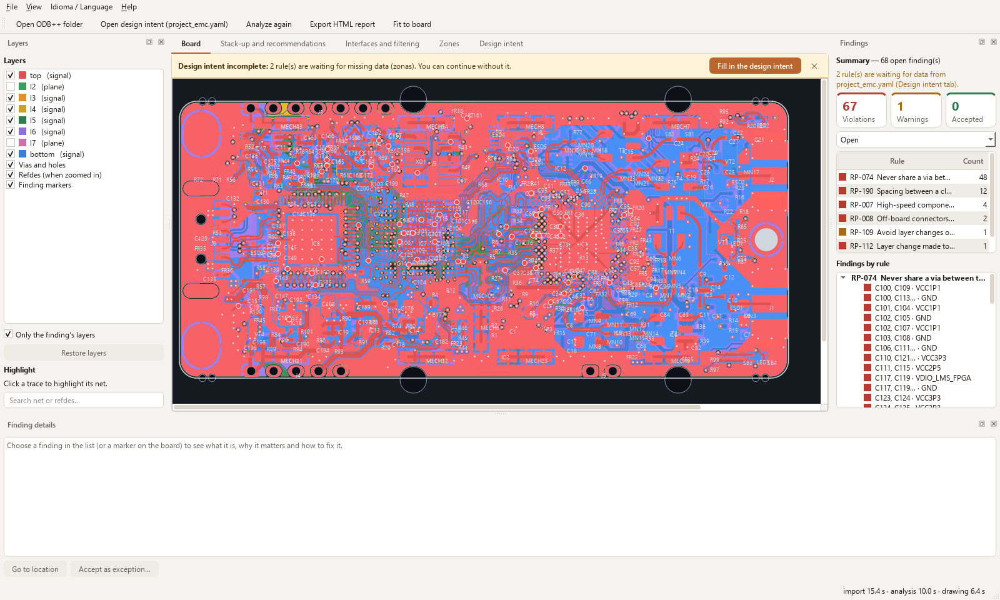
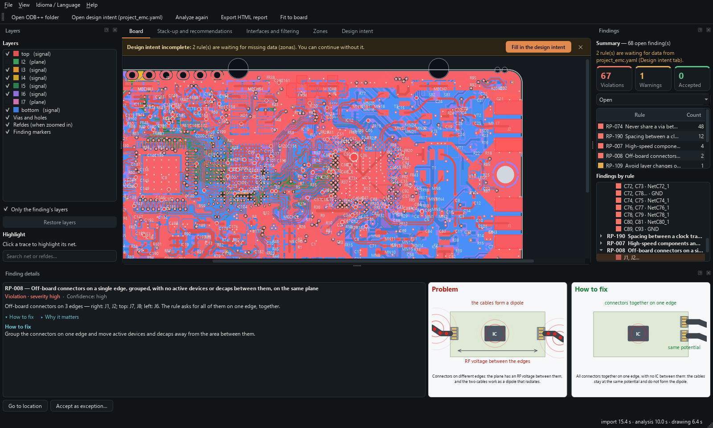
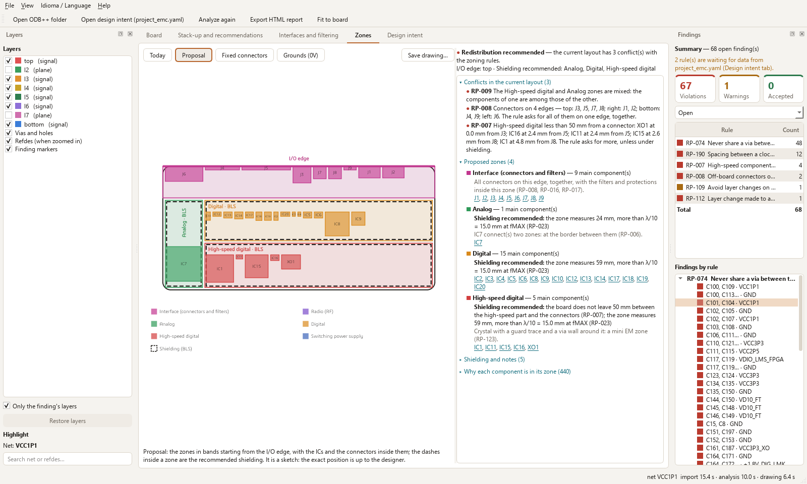
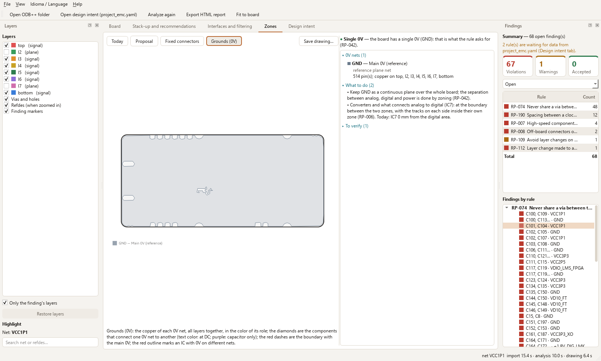
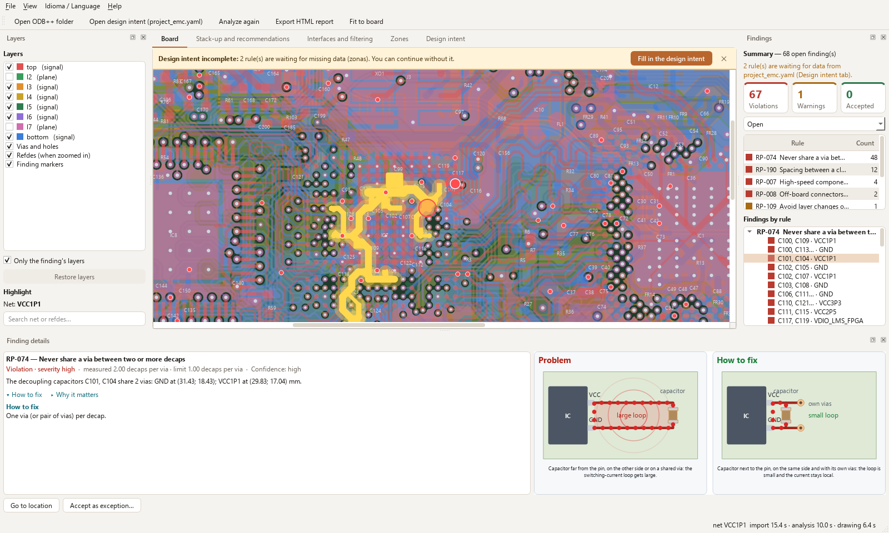
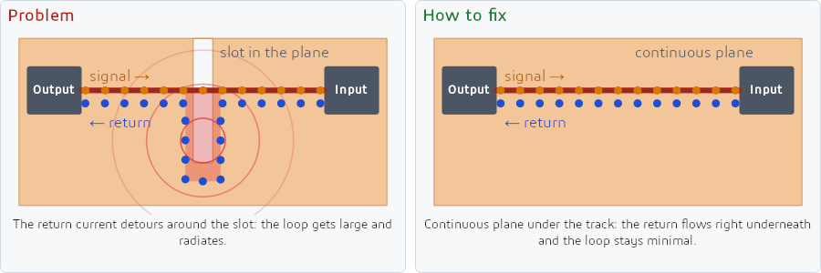
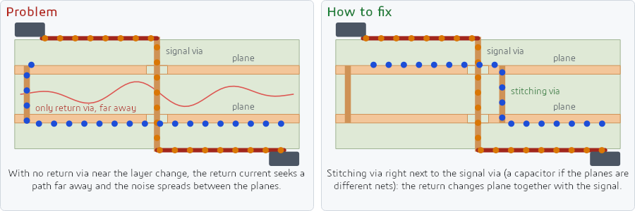
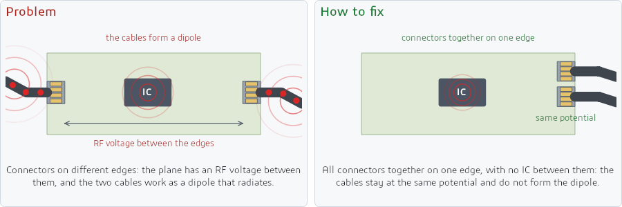
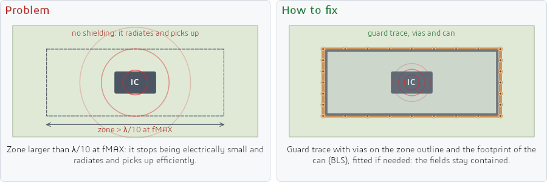

  <picture>
    <source media="(prefers-color-scheme: dark)" srcset="docs/img/logo_dark.png">
    
  </picture>

**EMC risk review for printed circuit boards, from their ODB++ export, before you send them to fab.**

EMClytics reads the ODB++ export of a board, applies a rule base of PCB layout good practices for EMC and shows each risk on the board: what was found, why it matters, how to fix it, its severity and how confident the finding is. Each finding comes with an animated illustration of the problem and the fix.

> **Free preview (0.x).** Findings indicate EMC risk according to layout good practices. They are not compliance results and do not replace pre-compliance testing or measurement.

## What it does

- **Reads ODB++** (folder, `.tgz` or `.zip`): layers, stack-up, tracks, planes (including negative ones), pads, vias, components and BOM properties.
  - Checked with exports from Altium Designer and Siemens Xpedition. The program follows the ODB++ 8.1 specification, so other tools that export ODB++ should open.
  - Rigid-flex boards (rigid and flexible zones) and HDI (blind, buried, stacked and staggered vias), in inches or millimeters.
- **288 EMC layout rules:** zoning, planes and return path, decoupling, interfaces and filtering, transmission lines, layer changes, stack-up, crystals, system ESD and others. Each rule gives the physical mechanism and the suggested fix.
- **30 automatic checks**, among them:
  - a track crossing a slot or split in the reference plane;
  - a split 0V (like AGND/DGND), connectors on different parts of the plane and stitching of boundaries and isolations;
  - an incomplete or hatched reference plane, and a fast track near the plane edge;
  - a decap far from the power pin, on the opposite side or on a shared via;
  - fast circuits and crystals near external connectors, and external connectors spread over several edges;
  - a zone larger than λ/10 at fMAX without provision for shielding;
  - layer changes on a critical net, without stitching vias or near a slot;
  - planes of the same net without stitching vias every λ/15;
  - clock track spacing;
  - plane resonance and shape;
  - stack-up (layer count, plane spacing).
- **A summary like a DRC's:** violations and warnings, one row per rule with the count and the Total. A click takes you to the occurrences.
- **A short detail for each finding:** the problem, how to fix it and, for the rules with a calculation, the calculation done with the board's values. The board shows the spot and, if you want, only its layers.
- **An animated illustration in each finding:** the problem and the fix side by side, with the current moving, to understand the context without being a specialist.
- **Missing data never passes:** a rule that depends on missing data appears as "not verified", with the reason. Manual rules appear as a checklist.
- **Stack-up cross-section**, with the role of each layer; **routing recommendations** by signal type; **interfaces and filtering** per connector, with the path from each pin to the IC.
- **Electromagnetic zones:** the zone of each IC (interface, radio, analog, digital, high-speed digital, switching power supply), whether the current layout mixes the zones and a proposal over the board outline, with the ICs, the connectors and where shielding goes. Another view keeps the connectors and antennas in place and arranges the rest around them.
- **Grounds (0V):** the role of each 0V net (main, AGND/DGND, chassis, input, isolated), where it is, what connects one to another and what to do.
- **HTML report** of the analysis, with the same summary, the zones and the 0V.
- **Light and dark theme**, which can follow Windows (**View › Theme**).
- **English and Portuguese:** interface, findings, rules and report in both languages (**Idioma / Language** menu).
- **An example board** inside the program (LimeSDR Mini 2.5), to see everything working with one click.
- **Command line** (`EMClytics-cli.exe`): the same report without opening the window, for use in scripts.
- **No AI and no cloud:** fixed rules, and everything runs on your computer.

| | |
|---|---|
|  |  |
| The board, with layers and the findings summary | Interfaces and filtering, per connector |
|  |  |
| Stack-up cross-section and recommendations by signal type | Dark theme |
|  |  |
| Zones: the proposal, with the ICs, the connectors and the shielding | Grounds (0V): the 0V nets and what to do |
|  | |
| A finding: what it is, the measurement, how to fix it and the illustration | |

## Illustrations

When you click a finding, the detail panel shows the problem and the fix, animated:

## Download

1. Download `EMClytics-<version>-windows-x64.zip` from [Releases](../../releases/latest). The SHA-256 of the file is in the notes of each version.
2. Extract it to a folder with a short path (e.g. `C:\EMClytics`) and open `EMClytics.exe`. Nothing needs to be installed.
3. The executable is not digitally signed yet. If Windows shows "Windows protected your PC", click **More info › Run anyway**.

Requirements: Windows 10 or 11, 64-bit.

**To be notified of new versions:** at the top of this page, click **Watch › Custom › Releases**. GitHub emails you on each release.

## How to use

1. Export the board as ODB++ from your CAD tool. In Altium Designer: **File › Fabrication Outputs › ODB++ Files**.
2. In EMClytics, **File › Open ODB++ folder** (or the exported `.tgz`/`.zip`), or drag the folder or the zip onto the window. To try the program without exporting anything, use **Open the example board**, on the start screen. The first time, the program opens in the Windows language; to change it, use the **Idioma / Language** menu (the change applies when the program restarts).
3. In the **Design intent** tab, give what the export does not carry: fMAX, critical nets and external connectors (the other fields, such as crystals and stack-up, go in `project_emc.yaml`). Without it, the rules that depend on this data stay "not verified".
4. Click a finding to see the spot on the board, the reason and the fix. If the finding is acceptable in your design, use **Accept as exception**, with a justification.

Step by step: [docs/quick_guide.md](docs/quick_guide.md). Commented design intent template: [docs/project_emc.example.yaml](docs/project_emc.example.yaml).

## Known limitations

- Checked with ODB++ from Altium Designer and Siemens Xpedition. Cadence, KiCad, Zuken and others have not been tested with real boards yet.
- Many exports do not include the dielectric layers: the stack-up rules stay not verified until you give the stack-up in the design intent.
- A hatched polygon is detected and reported, but does not become a plane: for the analysis, use a solid fill.
- Slots drawn as lines in the drill data are not read.
- On rigid-flex boards, the analysis uses the rigid zone's stack-up in the flexible zone too.
- The zone of each IC comes from what is connected to it (connector, crystal, antenna, switching supply inductor, fast nets, net names): check it and, if needed, correct it in `zonas[].funcao` in `project_emc.yaml`. The zone proposal is a sketch; the exact position and the routing are up to the designer.

What changed and what does not exist yet, version by version: [CHANGELOG.md](CHANGELOG.md).

## Free and Pro

This preview is free and includes everything that exists today. The **Pro** version, in preparation, will add a PDF report, comparison between revisions, project history and more checks. Nothing in Free will be removed.

## Privacy

EMClytics does not use the internet: the board and the results never leave your computer.

## Contact

Questions, ideas and EMC talk: [Discussions](../../discussions). Bug reports and feature requests: [Issues](../../issues). When reporting a bug, give the EMClytics version and the tool (with its version) used for the export. Do not attach board files you are not allowed to share.

## License

Free use under the terms of [LICENSE.md](LICENSE.md), an English translation; the Portuguese text in [LICENSE.pt-BR.md](LICENSE.pt-BR.md) prevails. EMClytics uses open-source components (Python, Qt for Python, Shapely/GEOS, NumPy, PyYAML), each with its own license, which comes with the program in the `licencas` folder.

Altium Designer, Xpedition and the other tools mentioned are trademarks of their owners. EMClytics is not affiliated with or endorsed by them.

Images: LimeSDR Mini 2.5 board, by Lime Microsystems, under the Solderpad Hardware License v2.1, analyzed with an illustrative design intent.
