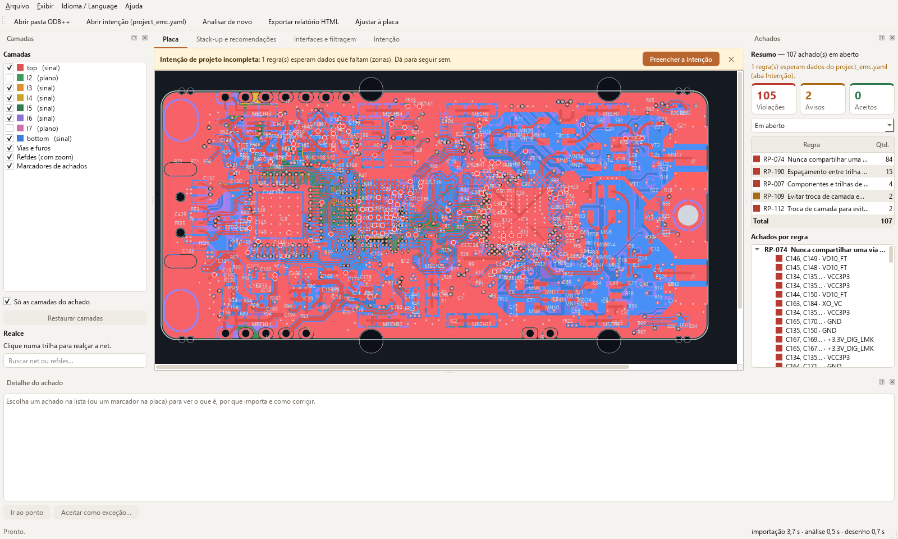
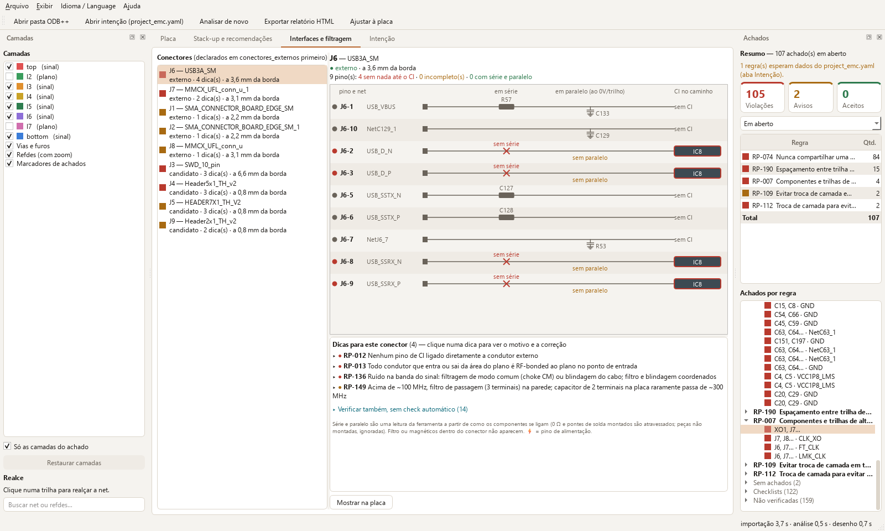
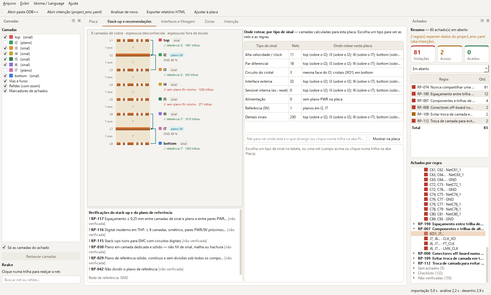
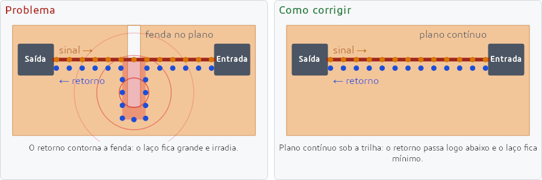
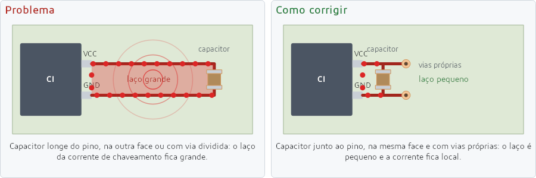
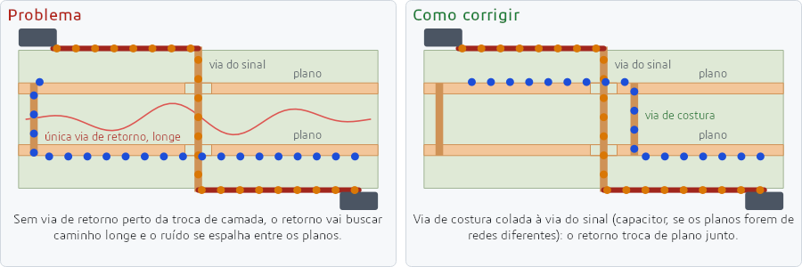
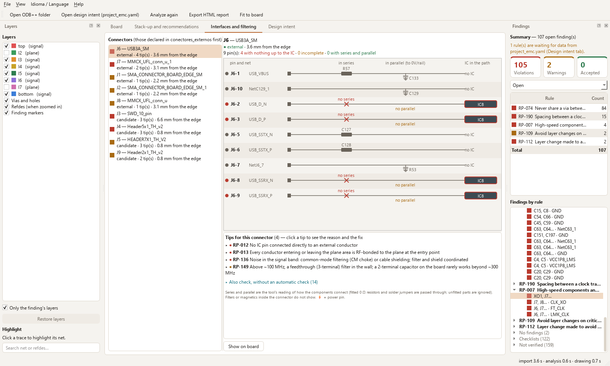
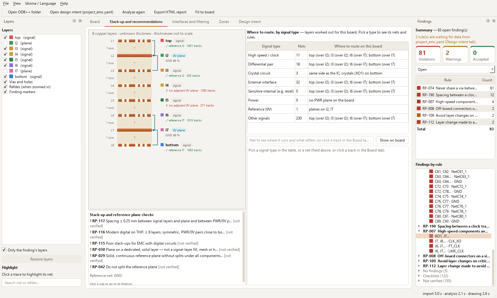
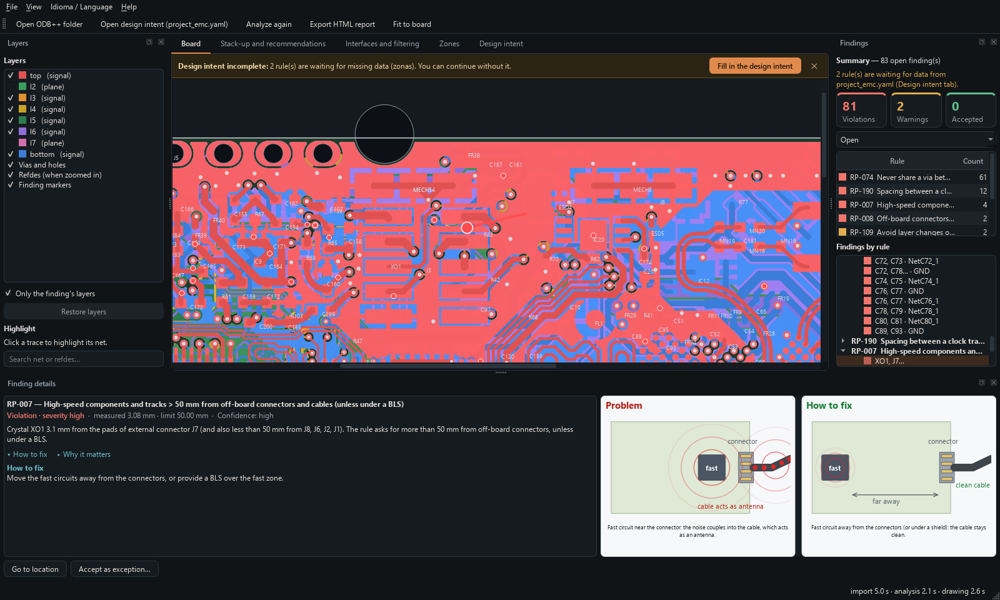
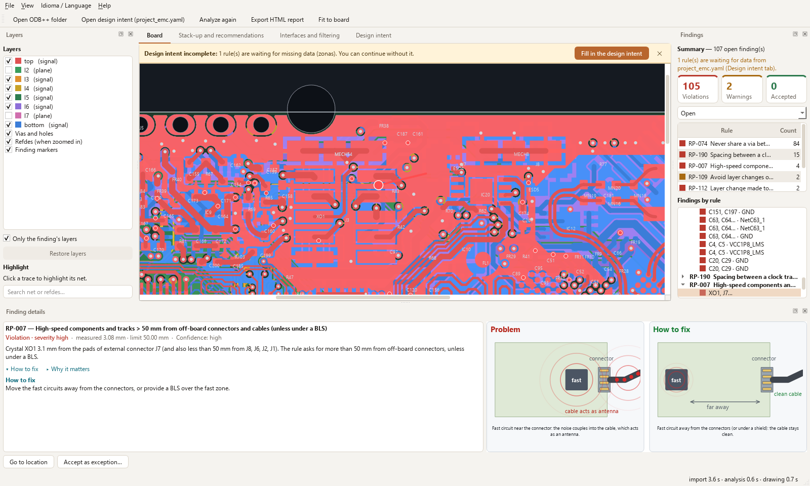

  <picture>
    <source media="(prefers-color-scheme: dark)" srcset="docs/img/logo_escuro.png">
    
  </picture>

**Indicação de riscos de EMC em placas de circuito impresso, a partir do ODB++, antes de mandar fabricar.**
*EMC risk review for PCBs, from their ODB++ export, before you send them to fab. [English below](#english).*

O EMClytics lê a exportação ODB++ da placa, aplica uma base de regras de boas práticas de layout para EMC e mostra cada risco na placa: o que foi encontrado, por que importa, como corrigir, a severidade e a confiança do achado. Cada achado vem com uma ilustração animada do problema e da correção.

> **Prévia gratuita (0.x).** Os achados indicam risco de EMC segundo boas práticas de layout. Não são resultado de conformidade e não substituem ensaio de pré-conformidade nem medição.

## O que faz

- **Lê o ODB++** (pasta, `.tgz` ou `.zip`): camadas, stack-up, trilhas, planos (inclusive negativos), pads, vias, componentes e propriedades de BOM.
  - Conferido com exportações do Altium Designer e do Siemens Xpedition. O programa segue a especificação ODB++ 8.1, então outras ferramentas que exportam ODB++ devem abrir.
  - Placas rígido-flex (zonas rígida e flexível) e HDI (vias cegas, enterradas, empilhadas e escalonadas), em polegada ou milímetro.
- **288 regras** de layout para EMC: zoneamento, planos e caminho de retorno, desacoplamento, interfaces e filtragem, linhas de transmissão, troca de camada, stack-up, cristais, ESD de sistema e outras. Cada regra traz o mecanismo físico e a correção sugerida.
- **25 checks automáticos**, entre eles:
  - trilha cruzando fenda ou divisão do plano de referência;
  - plano de referência incompleto ou hachurado, e trilha rápida perto da borda do plano;
  - decap longe do pino de alimentação, na face oposta ou com via compartilhada;
  - circuitos rápidos e cristais perto de conectores externos;
  - troca de camada em net crítica, sem vias de costura ou perto de fenda;
  - planos da mesma rede sem vias de costura a cada λ/15;
  - espaçamento de trilhas de clock;
  - ressonância e formato dos planos;
  - stack-up (camadas, espaçamento entre planos).
- **Resumo como o de um DRC:** violações e avisos, uma linha por regra com a contagem e o Total. O clique leva às ocorrências.
- **Detalhe curto em cada achado:** o problema, como corrigir e, nas regras com conta, a conta feita com os valores da placa. A placa mostra o ponto e, se você quiser, só as camadas dele.
- **Ilustração animada em cada achado:** o problema e a correção lado a lado, com a corrente andando, para entender o contexto sem ser especialista.
- **Nada passa por falta de dado:** regra que depende de um dado ausente aparece como "não verificada", com o motivo. As regras manuais aparecem como checklist.
- **Stack-up em corte**, com o papel de cada camada; **recomendações** de roteamento por tipo de sinal; **interfaces e filtragem** por conector, com o caminho de cada pino até o CI.
- **Relatório HTML** da análise, com o mesmo resumo.
- **Tema claro e escuro**, que pode seguir o Windows (**Exibir › Tema**).
- **Português e inglês:** interface, achados, regras e relatório nos dois idiomas (menu **Idioma / Language**).
- **Placa de exemplo** dentro do programa (LimeSDR Mini 2.5), para ver tudo funcionando com um clique.
- **Sem IA e sem nuvem:** regras fixas, e tudo roda no seu computador.

| | |
|---|---|
|  |  |
| A placa, com as camadas e o resumo dos achados | Interfaces e filtragem, por conector |
|  |  |
| Stack-up em corte e recomendações por tipo de sinal | Tema escuro |
|  | |
| Um achado: o que é, a medida, como corrigir e a ilustração | |

## Ilustrações

Ao clicar num achado, o painel de detalhe mostra o problema e a correção, animados:

## Download

1. Baixe o `EMClytics-<versão>-windows-x64.zip` em [Releases](../../releases/latest). O SHA-256 do arquivo está nas notas de cada versão.
2. Extraia numa pasta de caminho curto (ex.: `C:\EMClytics`) e abra `EMClytics.exe`. Não precisa instalar nada.
3. O executável ainda não tem assinatura digital. Se o Windows mostrar "O Windows protegeu o computador", clique em **Mais informações › Executar assim mesmo**.

Requisitos: Windows 10 ou 11, 64 bits.

**Para ser avisado de versões novas:** no alto desta página, clique em **Watch › Custom › Releases**. O GitHub avisa você por e-mail a cada versão.

## Como usar

1. Exporte a placa em ODB++ na sua ferramenta de CAD. No Altium Designer: **File › Fabrication Outputs › ODB++ Files**.
2. No EMClytics, **Arquivo › Abrir pasta ODB++** (ou o `.tgz`/`.zip` exportado), ou arraste a pasta ou o zip para a janela. Para conhecer o programa sem exportar nada, use **Abrir a placa de exemplo**, na tela inicial. Na primeira vez, o programa abre no idioma do Windows; para trocar, use o menu **Idioma / Language** (a troca vale quando o programa reabre).
3. Na aba **Intenção**, informe o que a exportação não traz: fMAX, nets críticas e conectores externos (os demais campos, como cristais e stack-up, ficam no `project_emc.yaml`). Sem isso, as regras que dependem desses dados ficam "não verificadas".
4. Clique num achado para ver o ponto na placa, o porquê e a correção. Se o achado for aceitável no seu projeto, use **Aceitar como exceção**, com justificativa.

Passo a passo: [docs/guia_rapido.md](docs/guia_rapido.md). Modelo comentado da intenção de projeto: [docs/project_emc.exemplo.yaml](docs/project_emc.exemplo.yaml).

## Limitações conhecidas

- Conferido com ODB++ do Altium Designer e do Siemens Xpedition. Cadence, KiCad, Zuken e outras ainda não foram testadas com placas reais.
- Muitas exportações não trazem as camadas dielétricas: as regras de stack-up ficam não verificadas até você informar o stack-up na intenção de projeto.
- Polígono hachurado é detectado e avisado, mas não vira plano: para a análise, use preenchimento sólido.
- Slots desenhados como linha na furação não são lidos.
- No rígido-flex, a análise usa o stack-up da zona rígida também na zona flexível.

O que mudou e o que ainda não existe, versão a versão: [CHANGELOG.md](CHANGELOG.md).

## Free e Pro

Esta prévia é gratuita e traz tudo o que existe hoje. A versão **Pro**, em preparação, vai somar relatório em PDF, comparação entre revisões, histórico de projetos e mais checks. Nada do que está no Free será retirado.

## Privacidade

O EMClytics não usa a internet: a placa e os resultados não saem do seu computador.

## Contato

Dúvidas, ideias e conversa sobre EMC: [Discussions](../../discussions). Relatos de erro e pedidos de melhoria: [Issues](../../issues). Ao relatar um erro, diga a versão do EMClytics e a ferramenta (com a versão) usada na exportação. Não anexe arquivos de placa que você não possa compartilhar.

## Licença

Uso gratuito nos termos de [LICENSE.md](LICENSE.md). O EMClytics usa componentes de código aberto (Python, Qt for Python, Shapely/GEOS, NumPy, PyYAML), cada um com a própria licença, que acompanha o programa na pasta `licencas`.

Altium Designer, Xpedition e as demais ferramentas citadas são marcas dos seus donos. O EMClytics não é afiliado a eles nem endossado por eles.

Imagens: placa LimeSDR Mini 2.5, da Lime Microsystems, sob a Solderpad Hardware License v2.1, analisada com uma intenção de projeto ilustrativa.

---

## English

**EMC risk review for printed circuit boards, from their ODB++ export, before you send them to fab.**

EMClytics reads the ODB++ export of a board, applies a rule base of PCB layout good practices for EMC and shows each risk on the board: what was found, why it matters, how to fix it, its severity and how confident the finding is. Each finding comes with an animated illustration of the problem and the fix.

> **Free preview (0.x).** Findings indicate EMC risk according to layout good practices. They are not compliance results and do not replace pre-compliance testing or measurement.

### What it does

- **Reads ODB++** (folder, `.tgz` or `.zip`): layers, stack-up, tracks, planes (including negative ones), pads, vias, components and BOM properties.
  - Checked with exports from Altium Designer and Siemens Xpedition. The program follows the ODB++ 8.1 specification, so other tools that export ODB++ should open.
  - Rigid-flex boards (rigid and flexible zones) and HDI (blind, buried, stacked and staggered vias), in inches or millimeters.
- **288 EMC layout rules:** zoning, planes and return path, decoupling, interfaces and filtering, transmission lines, layer changes, stack-up, crystals, system ESD and others. Each rule gives the physical mechanism and the suggested fix.
- **25 automatic checks**, among them:
  - a track crossing a slot or split in the reference plane;
  - an incomplete or hatched reference plane, and a fast track near the plane edge;
  - a decap far from the power pin, on the opposite side or on a shared via;
  - fast circuits and crystals near external connectors;
  - layer changes on a critical net, without stitching vias or near a slot;
  - planes of the same net without stitching vias every λ/15;
  - clock track spacing;
  - plane resonance and shape;
  - stack-up (layer count, plane spacing).
- **A summary like a DRC's:** violations and warnings, one row per rule with the count and the Total. A click takes you to the occurrences.
- **A short detail for each finding:** the problem, how to fix it and, for the rules with a calculation, the calculation done with the board's values. The board shows the spot and, if you want, only its layers.
- **An animated illustration in each finding:** the problem and the fix side by side, with the current moving, to understand the context without being a specialist.
- **Missing data never passes:** a rule that depends on missing data appears as "not verified", with the reason. Manual rules appear as a checklist.
- **Stack-up cross-section**, with the role of each layer; **routing recommendations** by signal type; **interfaces and filtering** per connector, with the path from each pin to the IC.
- **HTML report** of the analysis, with the same summary.
- **Light and dark theme**, which can follow Windows (**View › Theme**).
- **Portuguese and English:** interface, findings, rules and report in both languages (**Idioma / Language** menu).
- **An example board** inside the program (LimeSDR Mini 2.5), to see everything working with one click.
- **No AI and no cloud:** fixed rules, and everything runs on your computer.

| | |
|---|---|
|  |  |
| The board, with layers and the findings summary | Interfaces and filtering, per connector |
|  |  |
| Stack-up cross-section and recommendations by signal type | Dark theme |
|  | |
| A finding: what it is, the measurement, how to fix it and the illustration | |

### Download

1. Download `EMClytics-<version>-windows-x64.zip` from [Releases](../../releases/latest). The SHA-256 of the file is in the notes of each version.
2. Extract it to a folder with a short path (e.g. `C:\EMClytics`) and open `EMClytics.exe`. Nothing needs to be installed.
3. The executable is not digitally signed yet. If Windows shows "Windows protected your PC", click **More info › Run anyway**.

Requirements: Windows 10 or 11, 64-bit.

**To be notified of new versions:** at the top of this page, click **Watch › Custom › Releases**. GitHub emails you on each release.

### How to use

1. Export the board as ODB++ from your CAD tool. In Altium Designer: **File › Fabrication Outputs › ODB++ Files**.
2. In EMClytics, **File › Open ODB++ folder** (or the exported `.tgz`/`.zip`), or drag the folder or the zip onto the window. To try the program without exporting anything, use **Open the example board**, on the start screen. The first time, the program opens in the Windows language; to change it, use the **Idioma / Language** menu (the change applies when the program restarts).
3. In the **Design intent** tab, give what the export does not carry: fMAX, critical nets and external connectors (the other fields, such as crystals and stack-up, go in `project_emc.yaml`). Without it, the rules that depend on this data stay "not verified".
4. Click a finding to see the spot on the board, the reason and the fix. If the finding is acceptable in your design, use **Accept as exception**, with a justification.

Step by step: [docs/quick_guide.md](docs/quick_guide.md). Commented design intent template: [docs/project_emc.example.yaml](docs/project_emc.example.yaml). What changed and what does not exist yet, version by version: [CHANGELOG.en.md](CHANGELOG.en.md).

### Known limitations

- Checked with ODB++ from Altium Designer and Siemens Xpedition. Cadence, KiCad, Zuken and others have not been tested with real boards yet.
- Many exports do not include the dielectric layers: the stack-up rules stay not verified until you give the stack-up in the design intent.
- A hatched polygon is detected and reported, but does not become a plane: for the analysis, use a solid fill.
- Slots drawn as lines in the drill data are not read.
- On rigid-flex boards, the analysis uses the rigid zone's stack-up in the flexible zone too.

### Free and Pro

This preview is free and includes everything that exists today. The **Pro** version, in preparation, will add a PDF report, comparison between revisions, project history and more checks. Nothing in Free will be removed.

### Privacy

EMClytics does not use the internet: the board and the results never leave your computer.

### Contact

Questions, ideas and EMC talk: [Discussions](../../discussions). Bug reports and feature requests: [Issues](../../issues). When reporting a bug, give the EMClytics version and the tool (with its version) used for the export. Do not attach board files you are not allowed to share.

### License

Free use under the terms of [LICENSE.md](LICENSE.md) (Portuguese text, with an English summary). EMClytics uses open-source components (Python, Qt for Python, Shapely/GEOS, NumPy, PyYAML), each with its own license, which comes with the program in the `licencas` folder.

Altium Designer, Xpedition and the other tools mentioned are trademarks of their owners. EMClytics is not affiliated with or endorsed by them.

Images: LimeSDR Mini 2.5 board, by Lime Microsystems, under the Solderpad Hardware License v2.1, analyzed with an illustrative design intent.
